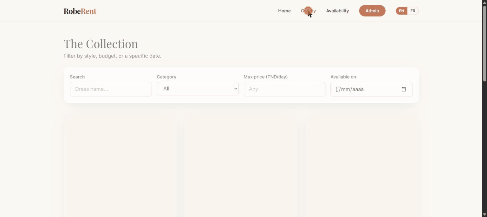
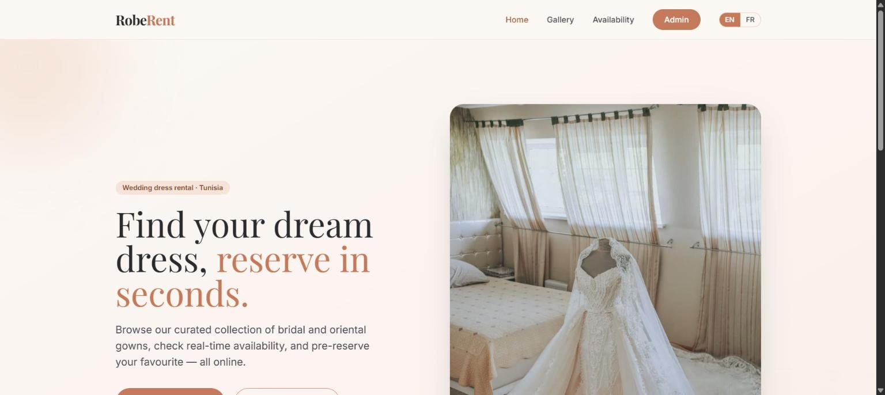
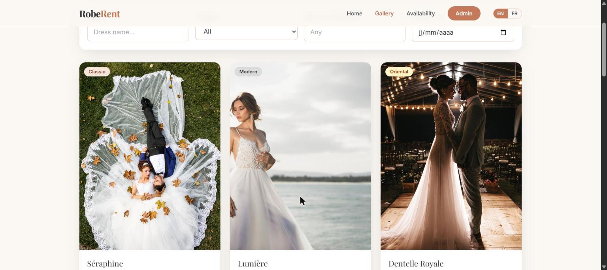
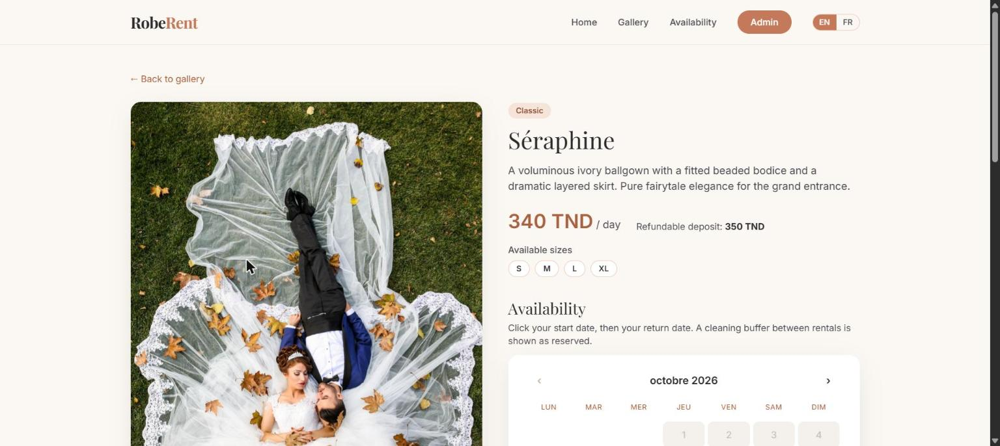
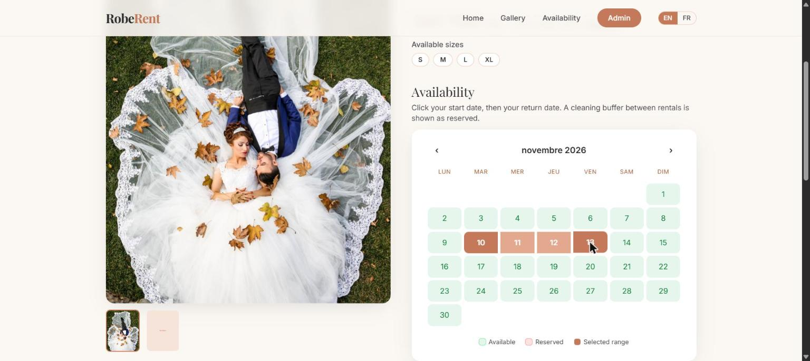
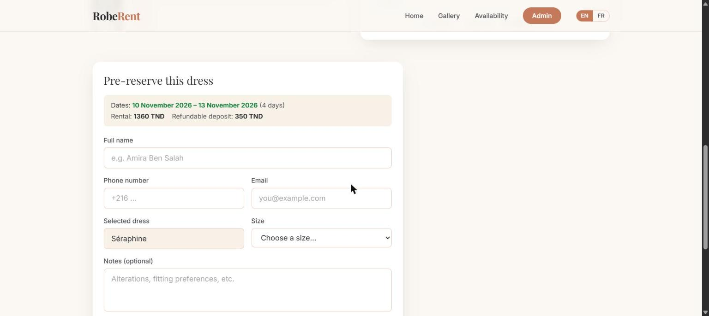
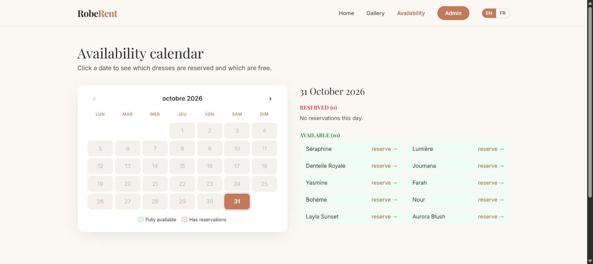

# RobeRent

A full-stack web application for wedding dress rental businesses in Tunisia.
Customers browse the collection, check availability, and pre-reserve a dress
online. Store managers track reservations and dates from a protected admin
dashboard.

**Live demo:** <https://robe-rent-1.vercel.app>



## Table of contents

- [Features](#features)
- [Screenshots](#screenshots)
- [Tech stack](#tech-stack)
- [Project structure](#project-structure)
- [Getting started](#getting-started)
- [Configuration](#configuration)
- [Admin accounts](#admin-accounts)
- [Scripts](#scripts)
- [Testing and linting](#testing-and-linting)
- [Deployment](#deployment)
- [API reference](#api-reference)
- [How availability works](#how-availability-works)
- [Security](#security)
- [Contributing](#contributing)
- [License](#license)

## Features

**Customer side**

- Public gallery with search and filters by category, price, and date.
- Per-dress availability calendar with a cleaning buffer between rentals.
- Pre-reservation form with real-time validation and a price summary.
- Global availability calendar showing which dresses are free on a given day.
- English and French interface.

**Admin side**

- Protected dashboard with JWT authentication and role support (admin, staff).
- Reservation management with a status lifecycle and audit trail.
- Calendar view, statistics, monthly history, and client history.
- Dress management with image upload and boutique block-out dates.

## Screenshots

| Home                         | Gallery                            |
| ---------------------------- | ---------------------------------- |
|  |  |

| Dress details                                 | Date selection                                   |
| --------------------------------------------- | ------------------------------------------------ |
|  |  |

| Reservation form                                     | Availability calendar                        |
| ---------------------------------------------------- | -------------------------------------------- |
|  |  |

## Tech stack

| Layer      | Technology                                                  |
| ---------- | ----------------------------------------------------------- |
| Frontend   | React, Vite, Tailwind CSS, React Router, Zustand, Axios     |
| Backend    | Node.js, Express                                            |
| Database   | MongoDB, Mongoose                                           |
| Validation | Zod, libphonenumber-js (server); inline validators (client) |
| Auth       | JWT, bcrypt-hashed admin accounts                           |
| Security   | helmet, express-rate-limit                                  |
| Logging    | winston, morgan                                             |
| Tests      | Jest, Supertest                                             |
| Tooling    | ESLint, Prettier, Docker                                    |

## Project structure

```
robe-rent/
├── client/                  React + Vite frontend
│   └── src/
│       ├── api/             Axios instance and service functions
│       ├── components/      Reusable UI components
│       ├── i18n/            Language context and translations
│       ├── pages/           Public and admin pages
│       ├── store/           Zustand auth store
│       └── utils/           Date, image, validation, auth helpers
├── server/                  Express API
│   ├── models/              Dress, Reservation, Admin, Image
│   ├── routes/              dresses, reservations, admin, images
│   ├── middleware/          JWT auth and Zod validation
│   ├── validators/          Zod schemas
│   ├── utils/               Date, logger, error helpers
│   ├── tests/               Jest and Supertest suites
│   └── server.js            Application entry point
├── docs/                    API documentation and README media
├── docker-compose.yml       MongoDB and API for local development
└── render.yaml              Render deployment blueprint
```

## Getting started

### Prerequisites

- Node.js 18 or later
- MongoDB (local instance or MongoDB Atlas), or Docker

### Run locally

1. Install dependencies from the repository root:

   ```bash
   npm run install:all
   ```

2. Create the backend environment file:

   ```bash
   cp server/.env.example server/.env
   ```

3. Create the first admin account (uses `ADMIN_USERNAME` and `ADMIN_PASSWORD`
   from `server/.env`):

   ```bash
   npm run seed:admin --prefix server
   ```

4. Start the API and the client in two terminals:

   ```bash
   npm run server    # API on http://localhost:5000
   npm run client    # Client on http://localhost:5173
   ```

The Vite dev server proxies `/api` to the backend, so no CORS setup is needed in
development. Dresses are added from the admin dashboard. To generate sample
reservations once dresses exist, run `npm run seed`.

### Run with Docker

```bash
docker compose up --build
docker compose exec server npm run seed:admin
```

The API is available at `http://localhost:5000` (health check: `/api/health`).
Start the client separately with `npm run client`.

## Configuration

Environment variables are read from `server/.env`. Only `server/.env.example` is
tracked in Git.

| Variable                | Default                 | Description                               |
| ----------------------- | ----------------------- | ----------------------------------------- |
| `PORT`                  | `5000`                  | API port                                  |
| `NODE_ENV`              | -                       | `development`, `production`, or `test`    |
| `MONGODB_URI`           | -                       | MongoDB connection string (required)      |
| `JWT_SECRET`            | -                       | Secret used to sign admin JWTs (required) |
| `JWT_EXPIRES_IN`        | `8h`                    | Admin token lifetime                      |
| `ADMIN_USERNAME`        | -                       | Bootstrap admin username                  |
| `ADMIN_PASSWORD`        | -                       | Bootstrap admin password                  |
| `CLIENT_ORIGIN`         | `http://localhost:5173` | Allowed CORS origin                       |
| `BOOKING_BUFFER_DAYS`   | `1`                     | Cleaning buffer between rentals           |
| `MIN_RENTAL_DAYS`       | `1`                     | Minimum rental length                     |
| `MAX_RENTAL_DAYS`       | `30`                    | Maximum rental length                     |
| `DEFAULT_PHONE_COUNTRY` | `TN`                    | Default country for phone validation      |
| `LOG_LEVEL`             | `debug` (development)   | winston log level                         |

## Admin accounts

Admin accounts are stored in MongoDB with bcrypt-hashed passwords. Run the
script from the `server/` directory so that it loads `server/.env`:

```bash
cd server

# Create or update an admin (role defaults to "admin")
node seed-admin.js <username> <password> [admin|staff]

# Bootstrap from ADMIN_USERNAME / ADMIN_PASSWORD in .env
npm run seed:admin
```

If the username already exists, its password and role are updated. Usernames
are case-insensitive.

## Scripts

**Repository root**

| Script                | Description                            |
| --------------------- | -------------------------------------- |
| `npm run install:all` | Install server and client dependencies |
| `npm run server`      | Start the API in watch mode            |
| `npm run client`      | Start the Vite dev server              |
| `npm test`            | Run the backend test suite             |
| `npm run lint`        | Lint server and client                 |
| `npm run format`      | Format the codebase with Prettier      |

**Server** (`npm run <script> --prefix server`)

| Script       | Description                       |
| ------------ | --------------------------------- |
| `start`      | Start the API                     |
| `dev`        | Start the API in watch mode       |
| `seed`       | Seed sample reservations          |
| `seed:admin` | Create or update an admin account |
| `test`       | Run Jest                          |

## Testing and linting

```bash
npm test          # Jest: validators, date utilities, errors, API
npm run lint      # ESLint (server and client)
npm run format    # Prettier
```

## Deployment

The application is deployed as three pieces: MongoDB Atlas (database), Render
(API), and Vercel (client). Vercel proxies `/api/*` to Render through
[client/vercel.json](client/vercel.json), so API calls and stored images stay
same-origin.

1. **Database.** Create a free M0 cluster on
   [MongoDB Atlas](https://www.mongodb.com/atlas), add a database user, allow
   network access, and copy the connection string.

2. **API on Render.** Create a Blueprint from this repository using
   [render.yaml](render.yaml), then set these variables in the dashboard:

   | Variable         | Value                    |
   | ---------------- | ------------------------ |
   | `MONGODB_URI`    | Atlas connection string  |
   | `CLIENT_ORIGIN`  | Vercel URL of the client |
   | `ADMIN_USERNAME` | Initial admin username   |
   | `ADMIN_PASSWORD` | Initial admin password   |

   `JWT_SECRET` is generated automatically. The health check path is
   `/api/health`. Free Render instances sleep after inactivity, so the first
   request after idle time can take 30 to 50 seconds.

3. **Admin account.** Create an admin in the Atlas database by running
   `seed-admin.js` from `server/` with `MONGODB_URI` pointing to Atlas, or by
   running `npm run seed:admin` in the Render shell.

4. **Client on Vercel.** Set the destination in `client/vercel.json` to your
   Render URL, import the repository, set the Root Directory to `client`, and
   deploy.

5. **Connect them.** Set Render's `CLIENT_ORIGIN` to the final Vercel URL and
   redeploy.

## API reference

| Method | Endpoint                             | Auth  | Description                            |
| ------ | ------------------------------------ | ----- | -------------------------------------- |
| GET    | `/api/health`                        | -     | Liveness check                         |
| GET    | `/api/dresses`                       | -     | List dresses (category, price filters) |
| GET    | `/api/dresses/:id`                   | -     | Single dress                           |
| GET    | `/api/dresses/:id/reserved-dates`    | -     | Unavailable days for a dress           |
| POST   | `/api/reservations`                  | -     | Create a reservation                   |
| GET    | `/api/images/:id`                    | -     | Stream a stored image                  |
| POST   | `/api/admin/login`                   | -     | Admin login, returns a JWT             |
| GET    | `/api/admin/reservations`            | admin | List all reservations                  |
| PATCH  | `/api/admin/reservations/:id/status` | admin | Update status (audit trail)            |
| GET    | `/api/admin/calendar`                | admin | Reservations grouped by day            |
| GET    | `/api/admin/stats`                   | admin | Dashboard statistics                   |
| GET    | `/api/admin/stats/history`           | admin | Monthly history                        |
| GET    | `/api/admin/clients`                 | admin | Client history                         |
| POST   | `/api/admin/dresses`                 | admin | Create a dress (multipart)             |
| PUT    | `/api/admin/dresses/:id`             | admin | Update a dress (multipart)             |
| DELETE | `/api/admin/dresses/:id`             | admin | Delete a dress and its reservations    |

Request and response examples are in [docs/API.md](docs/API.md).

## How availability works

Reservation dates are normalised to midnight UTC, so a booking is identified by
its calendar day. A dress is unavailable on a day if:

- an active (not cancelled or returned) reservation covers it, plus a
  `BOOKING_BUFFER_DAYS` cleaning buffer on either side, or
- the day is listed in the dress's `blockoutDates`.

Availability is checked twice: in the interface for instant feedback, and again
on `POST /api/reservations`, which is the source of truth and returns `409` on a
conflict to prevent double bookings.

## Security

- Admin passwords are bcrypt-hashed; no credentials are hardcoded.
- `helmet` sets secure HTTP headers, and `express-rate-limit` throttles the
  login and reservation endpoints.
- All request bodies and parameters are validated with Zod before any database
  access.
- Secrets are kept in `server/.env`, which is excluded from version control.

## Contributing

See [CONTRIBUTING.md](CONTRIBUTING.md) for guidelines and
[CHANGELOG.md](CHANGELOG.md) for release notes.

## License

ISC
